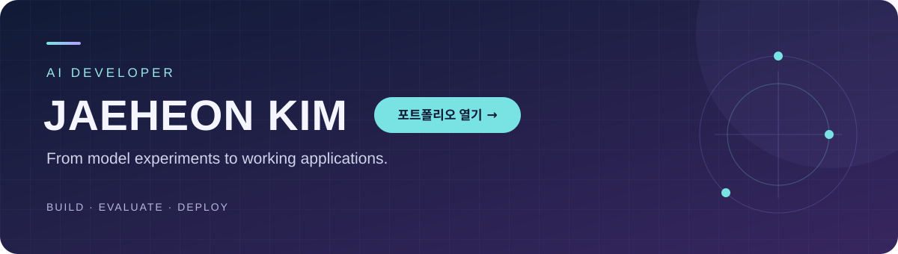

  

<h2 align="center">직접 구현하고 평가하며, AI를 서비스에 연결합니다.</h2>

  안녕하세요, AI 개발자 <b>김재헌</b>입니다. 
  LLM 애플리케이션의 응답을 검증하고, 비전 모델을 비교해 앱과 서버에 연결해 왔습니다. 
  팀에서는 필요한 기준을 먼저 맞추고, 문제를 공유하며 함께 해결합니다.

  <a href="https://jaeheonki.github.io"><b>📄 상세 포트폴리오</b></a> ·
  <a href="https://uj07096.tistory.com/">✍️ 기술 블로그</a> ·
  <a href="mailto:uj07096@gmail.com">✉️ uj07096@gmail.com</a> ·
  <a href="#대표-프로젝트">🚀 대표 프로젝트</a> ·
  <a href="#학습과-실험">📚 학습과 실험</a>

---

## 대표 프로젝트

프로젝트 소개와 함께 **제가 맡은 역할**, 시연과 결과 자료를 정리했습니다.

  아래 네 프로젝트의 <b>핵심 결정과 그 이유</b>, 결과 수치의 측정 조건, 트러블슈팅과 한계를 
  화면 캡처, 구성도와 함께 <a href="https://jaeheonki.github.io">상세 포트폴리오</a>에 정리했습니다.

<table>
<tr>
<td width="50%" valign="top">

### 📈 매출부스터
**소상공인 마케팅 컨설턴트 챗봇**

상권·검색 트렌드를 근거로 마케팅 전략을 제안합니다.

**담당** · 컨설턴트 챗봇의 LangGraph 설계·구현·평가

- 외부 조회 병렬 처리와 실패 시 대체 흐름 구성
- 고정 API 응답을 사용한 60문항 평가에서 실행 실패 **5건 → 0건**

`Python` `LangGraph` `LLM Judge`

**[코드](https://github.com/2026-Codeit-Part4-6Team/codeit-part4-6team-project)** · **[시연 영상](https://youtu.be/N4SLRAgrLik)** · **[담당 구현](https://github.com/2026-Codeit-Part4-6Team/codeit-part4-6team-project/tree/main/models/consult)** · **[평가 보고서](https://github.com/2026-Codeit-Part4-6Team/codeit-part4-6team-project/blob/main/docs/reports/consult_report.md)**

</td>
<td width="50%" valign="top">

### 💧 방울이
**수도 계량기 자동 검침 앱**

계량기 사진을 읽어 사용량·요금·환경 영향을 보여줍니다.

**담당** · PM, 모델 비교·선정, ONNX 변환·EC2 배포, 앱 연동·실기기 검증

- YOLOX-s 2단계 검출 모델을 FastAPI 서버에 연결
- Galaxy에서 인식값 확인·수정·저장·리포트 반영 검증

`YOLOX` `ONNX` `FastAPI` `AWS EC2`

**[코드·앱 화면](https://github.com/jaeheonki/smart-water-meter-kr)** · **[테스트 APK](https://github.com/jaeheonki/smart-water-meter-kr/releases)** · **[모델 선정](https://github.com/jaeheonki/smart-water-meter-kr/blob/main/docs/yolox-model-pipeline.md)** · **[배포 문서](https://github.com/jaeheonki/smart-water-meter-kr/blob/main/docs/deployment-guide.md)**

</td>
</tr>
<tr>
<td width="50%" valign="top">

### 📑 RFPilot
**제안요청서 기반 RAG 챗봇**

문서에서 필요한 정보를 찾고 여러 문서의 내용을 비교합니다.

**담당** · PM, 골든셋 검수, RAGAS 평가 코드, 품질·응답 시간 분석

- 단일문서 52문항·다중문서 40문항으로 모델 비교
- 체크포인트와 재평가로 점수 누락·실패 응답 확인

`Python` `RAG` `RAGAS`

**[코드·서비스 화면](https://github.com/jaeheonki/rfp-rag-chatbot)** · **[평가 코드·결과](https://github.com/jaeheonki/rfp-rag-chatbot/tree/main/evaluation)** · **[발표자료](https://github.com/jaeheonki/rfp-rag-chatbot/blob/main/docs/RFPilot_발표덱.pdf)**

</td>
<td width="50%" valign="top">

### 💊 이게머약
**알약 인식 및 약품 정보 조회 앱**

촬영한 알약을 인식하고 식약처의 약품 정보를 조회합니다.

**담당** · PM, RetinaNet 구현, YOLO 비교·튜닝, 데이터 오류 수정, API 연동

- 모델 비교 후 YOLO11s·11m의 12개 설정 실험
- 어노테이션 덮어쓰기 수정과 약품 API 2종 연동

`PyTorch` `YOLO` `FastAPI`

**[코드](https://github.com/jaeheonki/medicine-object-detection-project)** · **[시연 영상](https://youtu.be/b6sTlv_Z9cs)** · **[실험·보고서](https://github.com/jaeheonki/medicine-object-detection-project/tree/main/docs)**

</td>
</tr>
</table>

## 기술과 경험

| 분야 | 프로젝트에서 사용한 기술과 경험 |
| --- | --- |
| LLM 애플리케이션 | LangGraph 분기·병렬 실행·실패 시 대체 흐름, 외부 API 연동 |
| 평가 | RAGAS, LLM Judge, 골든셋 원문 검수, 실패 응답 재평가 |
| 컴퓨터 비전 | PyTorch·torchvision, RetinaNet, YOLO 모델 비교·튜닝 |
| 배포·연동 | ONNX Runtime, FastAPI, AWS EC2, Android 실기기 확인 |

## 추가 프로젝트

**[🎓 AI 생성 텍스트 판별 졸업작품](https://github.com/jaeheonki/ict-capstone)**  
KoBERT 기반 텍스트 분류와 Streamlit 화면을 구현한 대학 졸업작품입니다. 당시 실험 코드와 분석 노트북을 보관하고 있습니다.

## 학습과 실험

**[🧪 딥러닝 구현·비교 실험 모음](https://github.com/jaeheonki/my-deep-learning-prac)**  
비전·자연어·생성 모델을 실험하고 과정과 결과를 블로그에 기록했습니다.

| 관심 분야 | 노트북 바로가기 |
| --- | --- |
| 자연어 처리 | [Seq2Seq·Transformer 번역](https://github.com/jaeheonki/my-deep-learning-prac/blob/main/Seq2Seq_Transformer_Translation.ipynb) · [BERT·GPT 구현](https://github.com/jaeheonki/my-deep-learning-prac/blob/main/BERT_GPT_Document_Summarization.ipynb) |
| 컴퓨터 비전 | [객체 탐지 모델 비교](https://github.com/jaeheonki/my-deep-learning-prac/blob/main/Object_Detection_prac.ipynb) · [전이학습·미세조정](https://github.com/jaeheonki/my-deep-learning-prac/blob/main/fine_tuning_prac.ipynb) |
| 생성 모델 | [GAN·Diffusion 실험](https://github.com/jaeheonki/my-deep-learning-prac/blob/main/GAN_Diffusion_prac.ipynb) |

<b>📂 알고리즘·JavaScript 학습 기록 펼치기</b>

 

| 저장소 | 내용 |
| --- | --- |
| [백준·프로그래머스](https://github.com/jaeheonki/backjoon-programmers) | Python 알고리즘 문제 풀이 |
| [LeetCode](https://github.com/jaeheonki/leet-code-prac) | Python 자료구조·알고리즘 문제 풀이 |
| [JavaScript·Node.js](https://github.com/jaeheonki/js-prac) | 기초 문법, 미니 프로그램과 비동기 처리 실습 |

---

  <b>모델 선택의 이유부터 결과를 확인한 과정까지 기록합니다.</b> 
  <a href="https://uj07096.tistory.com/">Blog</a> · <a href="mailto:uj07096@gmail.com">uj07096@gmail.com</a>

